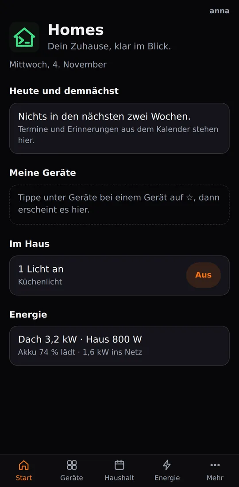
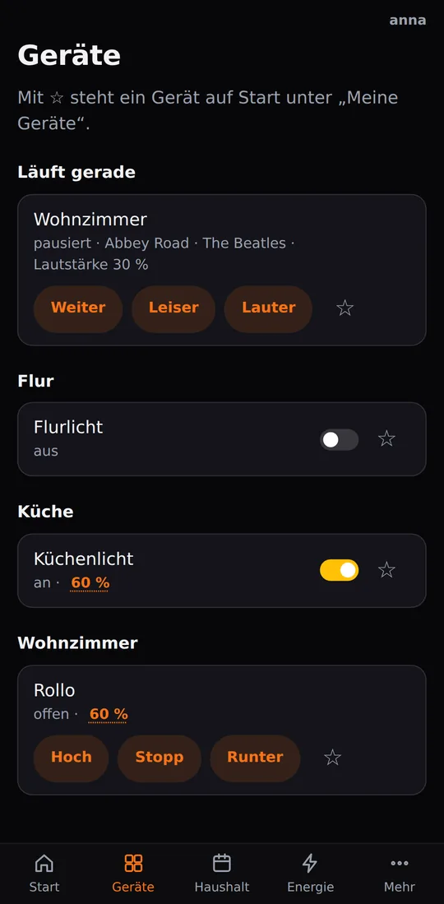
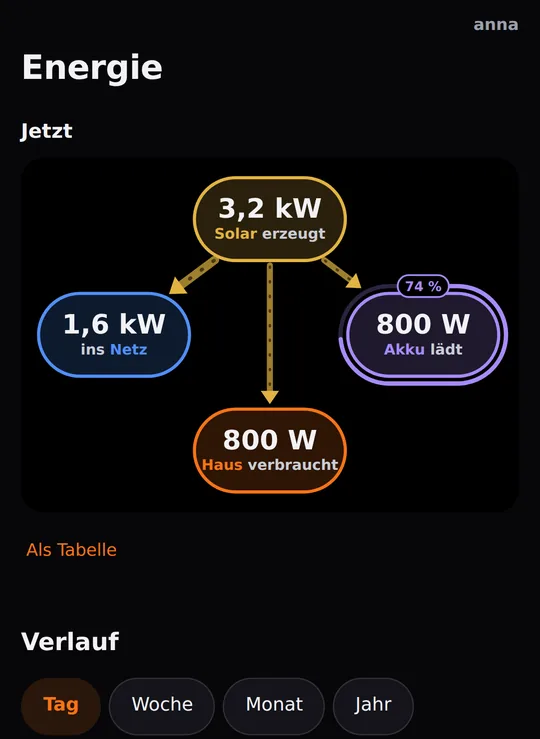
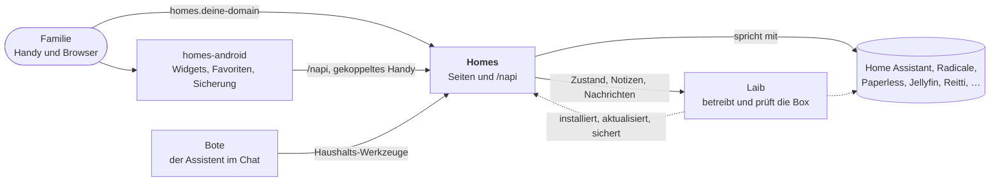

[English](README.md) · Deutsch · [Español](README.es.md) · [Français](README.fr.md)

# Homes

**Dein Zuhause auf einen Blick: Licht, Energie, Kalender, Einkaufsliste und
Notizen für die ganze Familie, geliefert von deiner eigenen Box, nicht aus
irgendeiner Cloud.**

Homes ist die Webseite der Familie auf einer [Laib](https://github.com/mdopp/laib)-Box.
Öffne `homes.<deine Domain>` auf einem Handy oder Computer, melde dich
einmal an, und das Haus ist da. Dazu gehört die Android-App
[homes-android](https://github.com/mdopp/homes-android), die dasselbe Haus
auf deinen Startbildschirm bringt.

  
  &nbsp;
  
  &nbsp;
  

Echte Screenshots aus der CI, mit Demo-Daten.

## Was du bekommst

- **Start:** die Termine und Erinnerungen von heute und den nächsten Tagen,
  die Geräte, die du mit ☆ angeheftet hast, welche Lichter an sind (mit
  *Alle aus*), wer zu Hause ist, die Energie in einer Zeile und eine
  ruhige Zeile dazu, ob mit der Box alles in Ordnung ist und deine Daten
  gesichert sind.
- **Geräte:** jeder Raum mit seinen Lampen, Schaltern, Rollläden und
  Lautsprechern. Ein Tipp schaltet, Helligkeit oder Position öffnen ein
  Fenster mit Schieberegler. Was sich anderswo ändert, steht nach wenigen
  Sekunden auf der Seite.
- **Energie:** Solar, Haus, Akku und Netz als Live-Bild; Tag, Woche, Monat
  und Jahr; dieses Jahr gegen das letzte und eine Prognose bis zum
  Jahresende.
- **Haushalt:** der gemeinsame Kalender und die Erinnerungen (per CalDAV,
  also sehen die Kalender-Apps der Handys sie auch), eine Einkaufsliste,
  die Mengen zusammenzählt und die Zutaten aus deinen Rezepten übernimmt,
  und Notizen als einfache Markdown-Dateien. Füg einen Rezept-Link ein,
  und daraus wird eine Rezept-Notiz.
- **Sprechen:** sprich mit dem Assistenten der Box, getippt oder per
  Mikrofon.
- **Mehr:** Dokumente (Paperless durchsuchen, einen Stapel mit gedruckten
  Trennblättern scannen, eine Datei hochladen), Musik (hochladen, eine
  Wunschliste, dein Discogs-Regal, eine Platte per Foto finden), Podcasts
  per Link, was du gesehen und gehört hast, dein Standortverlauf, die
  Sicherungen von deinem Handy, das Passwort fürs Netzlaufwerk und wie du
  die anderen Apps einrichtest.
- **Für Admins:** die Seite Box mit dem Zustand der Box, Familienmitglieder
  einladen und Handys koppeln. Freigaben bleiben in Laibs Inbox; Homes
  entscheidet selbst nie etwas.
- **Nur, was deine Box hat:** ein Bereich erscheint erst, wenn die Box den
  passenden Dienst betreibt (Home Assistant, Radicale, Paperless,
  Jellyfin, Audiobookshelf, Reitti, …).
- **Privat von Haus aus:** keine fremden Skripte oder Schriften, kein
  Tracking. Homes zählt anonym, welche Seiten und Knöpfe benutzt werden,
  nie wer ([wie](docs/USAGE.md)).

## Wie alles zusammenspielt

Laib installiert und überwacht Homes wie jeden anderen Dienst. Homes liest
und schaltet die Dienste des Haushalts direkt, fragt Laib nur nach dem
Zustand der Box und liefert der App ihre Schnittstelle (`/napi`).

## So bekommst du es

Homes kommt mit Laib als eingebaute Vorlage `homes`. Bitte deine Box darum
(`laib propose --add homes "…"`), gib es in Laibs Inbox frei, und es
antwortet unter `https://homes.<deine Domain>`. Die meisten Bereiche
erscheinen von selbst, sobald ihr Dienst auf der Box läuft.

Fürs Handy: Installier die [App](https://github.com/mdopp/homes-android)
und kopple sie unter *Mehr → Homes-App koppeln*.

## Wie es weitergeht

Homes wird in Module aufgeteilt, damit jede Box sich die Bereiche
aussucht, die sie will, und die App die Box fragt, was sie kann
([ADR 0001](docs/adr/0001-modules.md)).

## Contributing / Mitmachen

Ideen, Fehler und Wünsche sind als
[Issues](https://github.com/mdopp/homes/issues) willkommen. Am Code
arbeiten: Go, kein Framework, eine Seite pro Datei, und jede Seite wird in
einem echten Browser gegen Fakes getestet (`go run ./cmd/homesdemo` zeigt
sie lokal).

- [`AGENTS.md`](AGENTS.md): die Regeln, Code-Gates, Tests und das
  Ausliefern, für Menschen und Coding-Agents gleichermaßen (auf Englisch).
- [`docs/REFERENCE.md`](docs/REFERENCE.md): jede Seite und jeder
  `/napi`-Pfad im Detail (auf Englisch).
- [`docs/RUN.md`](docs/RUN.md): Homes von Hand starten, jede Variable (auf
  Englisch).
- [`docs/TAKEOUT.md`](docs/TAKEOUT.md): Kalender, Kontakte und Notizen von
  Google herüberholen.
- [`docs/adr/`](docs/adr/): die eigenen Entscheidungen von Homes; die von
  Laib stehen in [mdopp/laib](https://github.com/mdopp/laib/tree/main/docs/adr).
