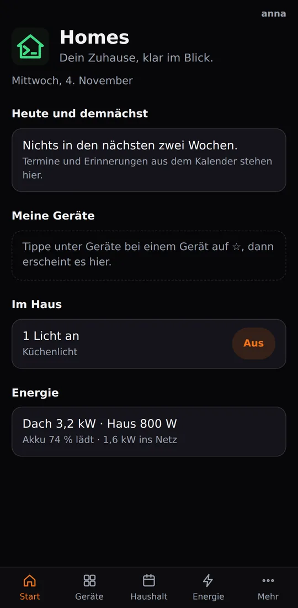
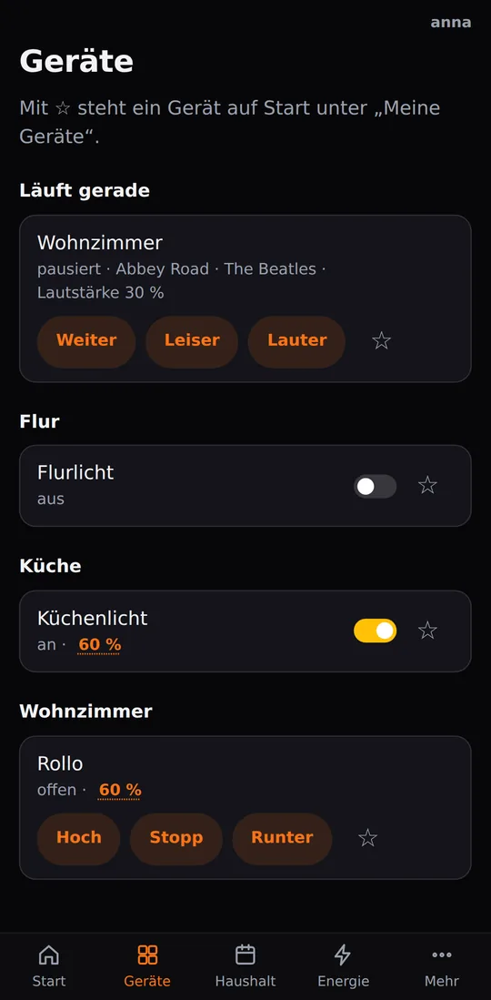
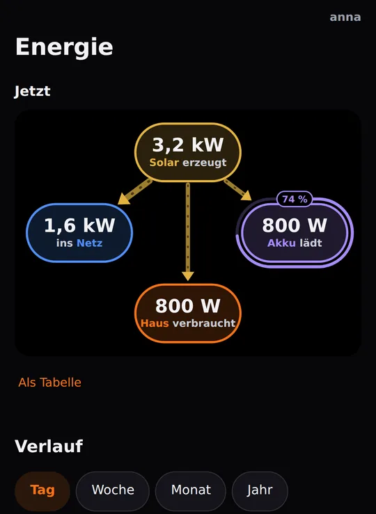
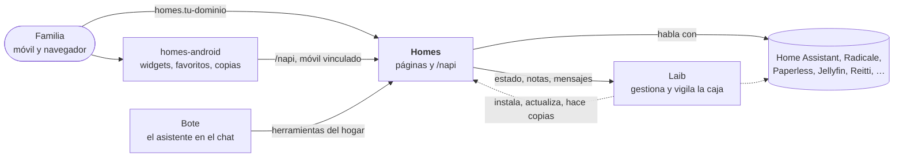

[English](README.md) · [Deutsch](README.de.md) · Español · [Français](README.fr.md)

# Homes

**Tu casa de un vistazo: luces, energía, calendario, lista de la compra y
notas para toda la familia, servidos por tu propia caja, no por la nube de
otros.**

Homes es la página web de la familia en una caja [Laib](https://github.com/mdopp/laib).
Abre `homes.<tu dominio>` en cualquier móvil u ordenador, inicia sesión
una vez y ahí tienes tu casa. Su compañera es la app de Android
[homes-android](https://github.com/mdopp/homes-android), que lleva la misma
casa a tu pantalla de inicio.

  
  &nbsp;
  
  &nbsp;
  

Capturas reales de la CI, con datos de demostración.

## Qué obtienes

La app está en alemán; los nombres de las páginas y botones aparecen aquí
tal como los ves, con una breve traducción.

- **Start** (inicio): las citas y recordatorios de hoy y de los próximos
  días, los dispositivos que fijaste con ☆, qué luces están encendidas
  (con *Alle aus*, «apagar todo»), quién está en casa, la energía en una
  línea y una línea tranquila que te dice si la caja va bien y tus datos
  tienen copia de seguridad.
- **Geräte** (dispositivos): cada habitación con sus lámparas,
  interruptores, persianas y altavoces. Un toque enciende o apaga; el
  brillo o la posición abren un panel con un control deslizante. Lo que
  cambia en otro sitio aparece en la página en pocos segundos.
- **Energie** (energía): solar, casa, batería y red en una imagen en
  directo; el día, la semana, el mes y el año; este año frente al
  anterior y una previsión hasta final de año.
- **Haushalt** (hogar): el calendario y los recordatorios compartidos
  (CalDAV, así que las apps de calendario de los móviles también los
  ven), una lista de la compra que suma cantidades y toma los
  ingredientes de tus recetas, y notas como simples archivos Markdown.
  Pega el enlace de una receta y se convierte en una nota de receta.
- **Sprechen** (hablar): habla con el asistente de la caja escribiendo o
  con el micrófono.
- **Mehr** (más): documentos (buscar en Paperless, escanear un montón de
  papeles con hojas separadoras impresas, subir un archivo), música
  (subirla, una lista de deseos, tu estantería de Discogs, un disco
  encontrado a partir de una foto), pódcasts por enlace, lo que has visto
  y escuchado, tu historial de ubicaciones, las copias de seguridad de tu
  móvil, la contraseña de la unidad de red y cómo configurar las demás
  apps.
- **Para administradores:** la página Box con el estado de la caja,
  invitar a miembros de la familia y vincular móviles. Las aprobaciones
  se quedan en la bandeja de entrada (Inbox) de Laib; Homes nunca decide
  nada por su cuenta.
- **Solo lo que tiene tu caja:** cada sección aparece solo cuando la caja
  ejecuta su servicio (Home Assistant, Radicale, Paperless, Jellyfin,
  Audiobookshelf, Reitti, …).
- **Privado de serie:** sin scripts ni fuentes externas, sin rastreo.
  Homes cuenta de forma anónima qué páginas y botones se usan, nunca
  quién ([cómo](docs/USAGE.md)).

## Cómo encaja todo

Laib instala y vigila Homes como cualquier otro servicio. Homes lee y
controla directamente los servicios del hogar, solo le pregunta a Laib
por el estado de la caja y ofrece a la app su API (`/napi`).

## Cómo conseguirlo

Homes viene con Laib como la plantilla integrada `homes`. Pídesela a tu
caja (`laib propose --add homes "…"`), apruébala en la Inbox de Laib y
responderá en `https://homes.<tu dominio>`. La mayoría de las secciones
aparecen solas en cuanto su servicio funciona en la caja.

Para el móvil: instala la [app](https://github.com/mdopp/homes-android) y
vincúlala en *Mehr → Homes-App koppeln* («vincular la app Homes»).

## Lo que viene

Homes se está dividiendo en módulos, para que cada caja elija las
secciones que quiere y la app le pregunte a la caja qué sabe hacer
([ADR 0001](docs/adr/0001-modules.md)).

## Contributing / Mitmachen

Las ideas, los errores y los deseos son bienvenidos como
[issues](https://github.com/mdopp/homes/issues). Para trabajar en el
código: Go, sin framework, una página por archivo, y cada página probada
en un navegador real contra fakes (`go run ./cmd/homesdemo` las muestra
en local).

- [`AGENTS.md`](AGENTS.md): las reglas, los controles de código, las
  pruebas y la publicación, para personas y agentes de programación por
  igual (en inglés).
- [`docs/REFERENCE.md`](docs/REFERENCE.md): cada página y cada ruta
  `/napi` en detalle (en inglés).
- [`docs/RUN.md`](docs/RUN.md): ejecutar Homes a mano, cada variable (en
  inglés).
- [`docs/TAKEOUT.md`](docs/TAKEOUT.md): traer calendarios, contactos y
  notas desde Google (en alemán).
- [`docs/adr/`](docs/adr/): las decisiones propias de Homes; las de Laib
  están en [mdopp/laib](https://github.com/mdopp/laib/tree/main/docs/adr).
