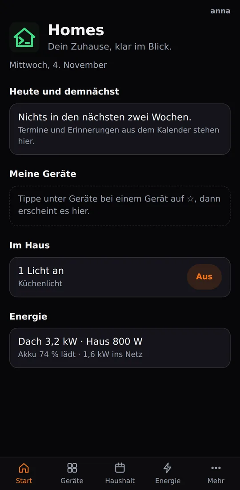
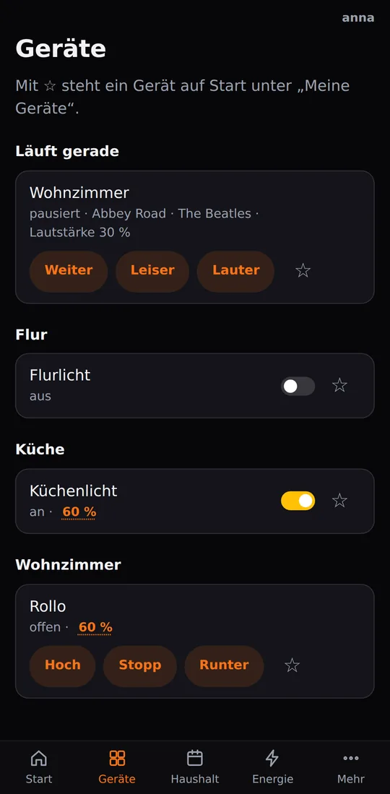
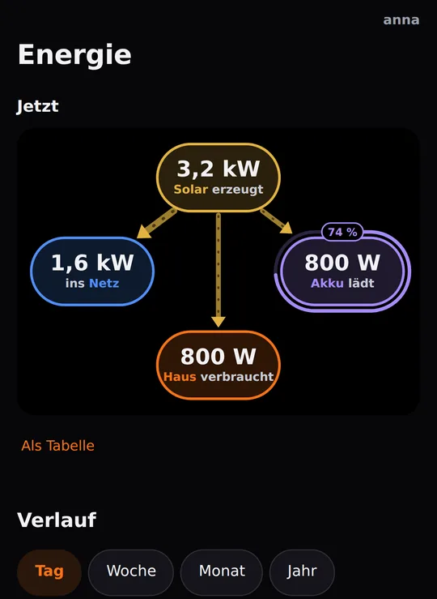
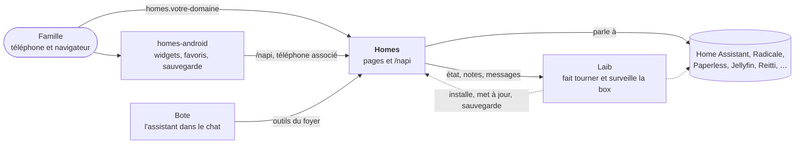

[English](README.md) · [Deutsch](README.de.md) · [Español](README.es.md) · Français

# Homes

**Votre maison en un coup d'œil : lumières, énergie, agenda, liste de
courses et notes pour toute la famille, servis par votre propre box, pas
par le cloud de quelqu'un d'autre.**

Homes est la page web de la famille sur une box [Laib](https://github.com/mdopp/laib).
Ouvrez `homes.<votre domaine>` sur n'importe quel téléphone ou ordinateur,
connectez-vous une fois, et la maison est là. Son partenaire est l'app
Android [homes-android](https://github.com/mdopp/homes-android), qui met la
même maison sur votre écran d'accueil.

  
  &nbsp;
  
  &nbsp;
  

De vraies captures d'écran de la CI, sur des données de démonstration.

## Ce que vous obtenez

L'app est en allemand ; les noms des pages et des boutons apparaissent
ici tels que vous les voyez, avec une courte traduction.

- **Start** (accueil) : les rendez-vous et rappels du jour et des jours
  suivants, les appareils que vous avez épinglés avec ☆, les lumières
  allumées (avec *Alle aus*, « tout éteindre »), qui est à la maison,
  l'énergie en une ligne, et une ligne calme qui dit si la box va bien et
  si vos données sont sauvegardées.
- **Geräte** (appareils) : chaque pièce avec ses lampes, interrupteurs,
  volets et enceintes. Un appui allume ou éteint ; la luminosité ou la
  position ouvre un panneau avec un curseur. Ce qui change ailleurs
  apparaît sur la page en quelques secondes.
- **Energie** (énergie) : solaire, maison, batterie et réseau en image en
  direct ; le jour, la semaine, le mois et l'année ; cette année face à
  l'année dernière, et une prévision jusqu'à la fin de l'année.
- **Haushalt** (foyer) : l'agenda et les rappels partagés (CalDAV, donc
  les apps d'agenda des téléphones les voient aussi), une liste de
  courses qui additionne les quantités et reprend les ingrédients de vos
  recettes, et des notes en simples fichiers Markdown. Collez le lien
  d'une recette, et elle devient une note de recette.
- **Sprechen** (parler) : parlez à l'assistant de la box, au clavier ou au
  micro.
- **Mehr** (plus) : documents (chercher dans Paperless, scanner une pile
  avec des feuilles de séparation imprimées, envoyer un fichier), musique
  (l'envoyer, une liste d'envies, votre étagère Discogs, un disque
  retrouvé à partir d'une photo), podcasts par lien, ce que vous avez vu
  et écouté, votre historique de position, les sauvegardes de votre
  téléphone, le mot de passe du lecteur réseau, et comment configurer les
  autres apps.
- **Pour les admins :** la page Box avec l'état de la box, inviter des
  membres de la famille et associer des téléphones. Les validations
  restent dans la boîte de réception (Inbox) de Laib ; Homes ne décide
  jamais rien lui-même.
- **Seulement ce que votre box a :** chaque rubrique n'apparaît que si la
  box fait tourner son service (Home Assistant, Radicale, Paperless,
  Jellyfin, Audiobookshelf, Reitti, …).
- **Privé par défaut :** aucun script ni police venus d'ailleurs, aucun
  pistage. Homes compte de façon anonyme quelles pages et quels boutons
  sont utilisés, jamais par qui ([comment](docs/USAGE.md)).

## Comment tout s'articule

Laib installe et surveille Homes comme n'importe quel autre service. Homes
lit et commande directement les services du foyer, ne demande à Laib que
l'état de la box, et fournit son API à l'app (`/napi`).

## L'obtenir

Homes est livré avec Laib sous la forme du modèle intégré `homes`.
Demandez-le à votre box (`laib propose --add homes "…"`), validez-le dans
l'Inbox de Laib, et il répond sur `https://homes.<votre domaine>`. La
plupart des rubriques apparaissent d'elles-mêmes dès que leur service
tourne sur la box.

Pour le téléphone : installez l'[app](https://github.com/mdopp/homes-android)
et associez-la sous *Mehr → Homes-App koppeln* (« associer l'app Homes »).

## La suite

Homes est en train d'être découpé en modules, pour que chaque box choisisse
les rubriques qu'elle veut et que l'app demande à la box ce qu'elle sait
faire ([ADR 0001](docs/adr/0001-modules.md)).

## Contributing / Mitmachen

Idées, bugs et envies sont les bienvenus sous forme
d'[issues](https://github.com/mdopp/homes/issues). Pour travailler sur le
code : Go, sans framework, une page par fichier, et chaque page testée
dans un vrai navigateur contre des fakes (`go run ./cmd/homesdemo` les
affiche en local).

- [`AGENTS.md`](AGENTS.md) : les règles, les contrôles de code, les tests
  et la publication, pour les humains comme pour les agents de code (en
  anglais).
- [`docs/REFERENCE.md`](docs/REFERENCE.md) : chaque page et chaque chemin
  `/napi` en détail (en anglais).
- [`docs/RUN.md`](docs/RUN.md) : lancer Homes à la main, chaque variable
  (en anglais).
- [`docs/TAKEOUT.md`](docs/TAKEOUT.md) : rapatrier agendas, contacts et
  notes depuis Google (en allemand).
- [`docs/adr/`](docs/adr/) : les décisions propres à Homes ; celles de
  Laib sont dans [mdopp/laib](https://github.com/mdopp/laib/tree/main/docs/adr).
