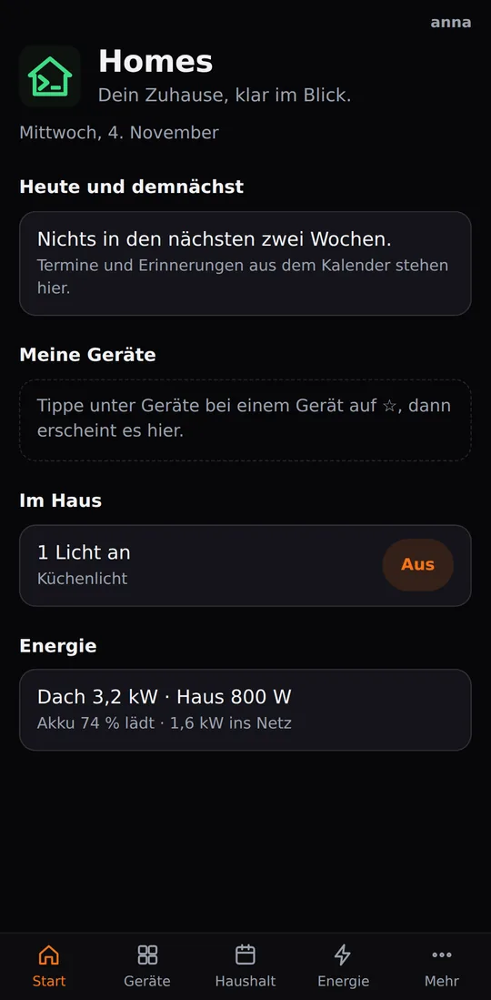
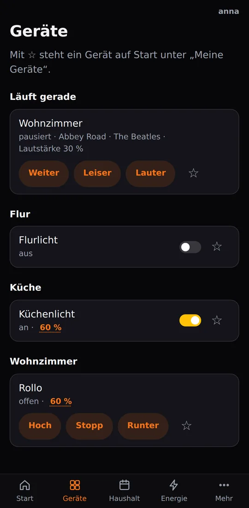
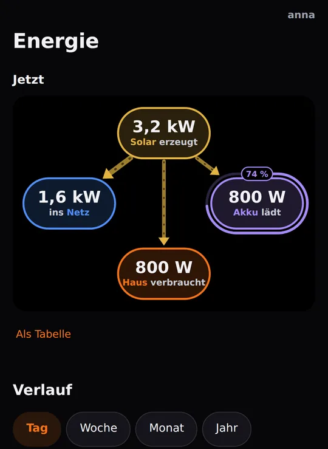
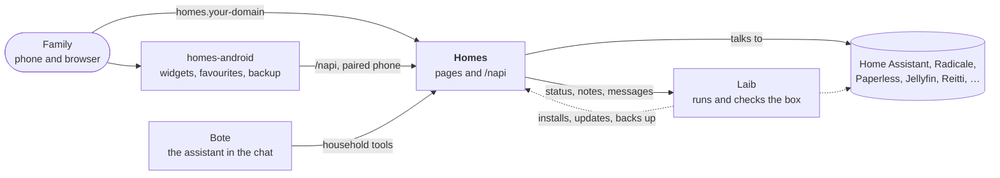

# Homes

**Your home at a glance: lights, energy, calendar, shopping list and notes
for the whole family, served by your own box, not by somebody's cloud.**

> **Language:** the pages and the app speak German today; English, Spanish and French are on the way.

Homes is the family's web page on a [Laib](https://github.com/mdopp/laib)
box. Open `homes.<your domain>` on any phone or computer, sign in once,
and the house is there. Its partner is the Android app
[homes-android](https://github.com/mdopp/homes-android), which puts the
same house on your home screen.

  
  &nbsp;
  
  &nbsp;
  

Real screenshots from CI, on demo data.

## What you get

- **Start:** today's and the coming appointments and reminders, the
  devices you pinned with ☆, which lights are on (with *Alle aus*), who is
  home, the energy in one line, and one calm line saying whether the box
  is fine and your data is backed up.
- **Geräte:** every room with its lamps, switches, shutters and speakers.
  A tap switches, the brightness or position opens a sheet with a slider.
  What changes elsewhere shows up on the page within seconds.
- **Energie:** solar, house, battery and grid as a live picture; the day,
  week, month and year; this year against last year, and a forecast to
  the year's end.
- **Haushalt:** the shared calendar and reminders (CalDAV, so the phones'
  calendar apps see them too), a shopping list that adds up amounts and
  takes the ingredients from your recipes, and notes as plain Markdown
  files. Paste a recipe link and it becomes a recipe note.
- **Sprechen:** talk to the box's assistant by typing or by microphone.
- **Mehr:** documents (search Paperless, scan a stack with printed
  separator sheets, upload a file), music (upload, a wish list, your
  Discogs shelf, a record found from a photo), podcasts by link, what you
  watched and heard, your location history, the backups from your phone,
  the network drive's password, and how to set up the other apps.
- **For admins:** the Box page with the box's health, inviting family
  members and pairing phones. Approvals stay in Laib's Inbox; Homes never
  decides anything itself.
- **Only what your box has:** each area shows up only when the box runs
  its service (Home Assistant, Radicale, Paperless, Jellyfin,
  Audiobookshelf, Reitti, …).
- **Private by default:** no outside scripts or fonts, no tracking. Homes
  counts anonymously which pages and buttons are used, never who
  ([how](docs/USAGE.md)).

## How it fits together

Laib installs and watches Homes like every other service. Homes reads and
switches the household's services directly, asks Laib only for the box's
state, and serves the app its API (`/napi`).

## Get it

Homes comes with Laib as the built-in `homes` template. On your box, ask
for it (`laib propose --add homes "…"`), approve it in Laib's Inbox, and it
answers at `https://homes.<your domain>`. Most areas appear by
themselves once their service runs on the box.

For the phone: install the [app](https://github.com/mdopp/homes-android)
and pair it under *Mehr → Homes-App koppeln*.

## What's next

Homes is being cut into modules, so that each box picks the areas it
wants and the app asks the box what it can do
([ADR 0001](docs/adr/0001-modules.md)).

## Contributing / Mitmachen

Ideas, bugs and wishes are welcome as
[issues](https://github.com/mdopp/homes/issues). To work on the code:
Go, no framework, one page per file, and every page tested in a real
browser against fakes (`go run ./cmd/homesdemo` shows them locally).

- [`AGENTS.md`](AGENTS.md): the rules, code gates, tests and release, for
  people and coding agents alike.
- [`docs/DOMAIN.md`](docs/DOMAIN.md): the household's terms, who owns what, and the chains of events.
- [`docs/REFERENCE.md`](docs/REFERENCE.md): every page and `/napi` path
  in detail.
- [`docs/RUN.md`](docs/RUN.md): running Homes by hand, every variable.
- [`docs/TAKEOUT.md`](docs/TAKEOUT.md): bringing calendars, contacts and
  notes over from Google (in German).
- [`docs/adr/`](docs/adr/): Homes' own decisions; Laib's are in
  [mdopp/laib](https://github.com/mdopp/laib/tree/main/docs/adr).
