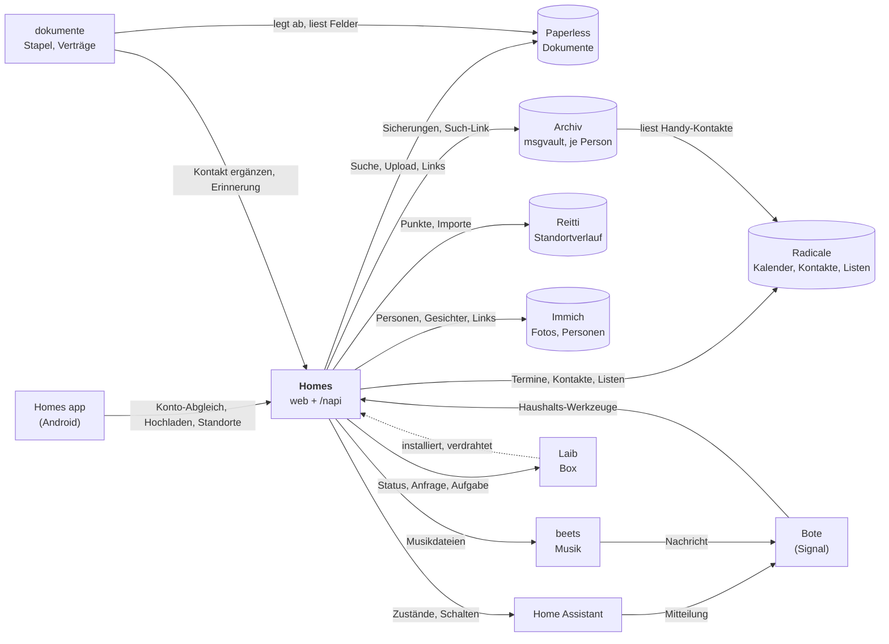
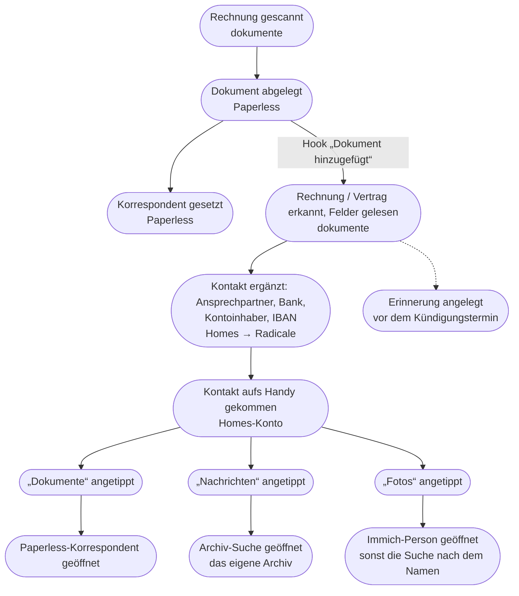
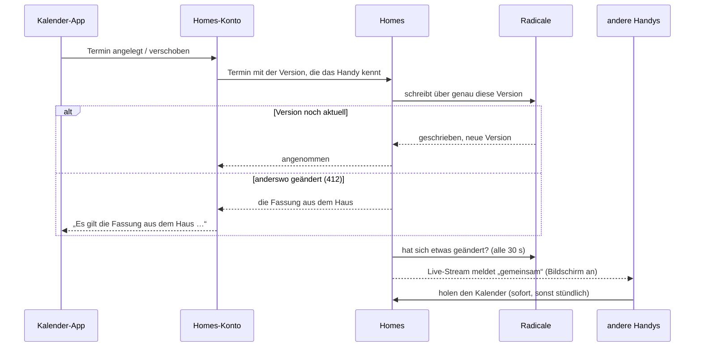
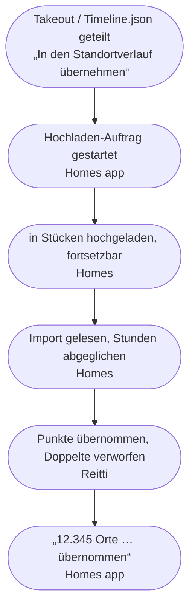
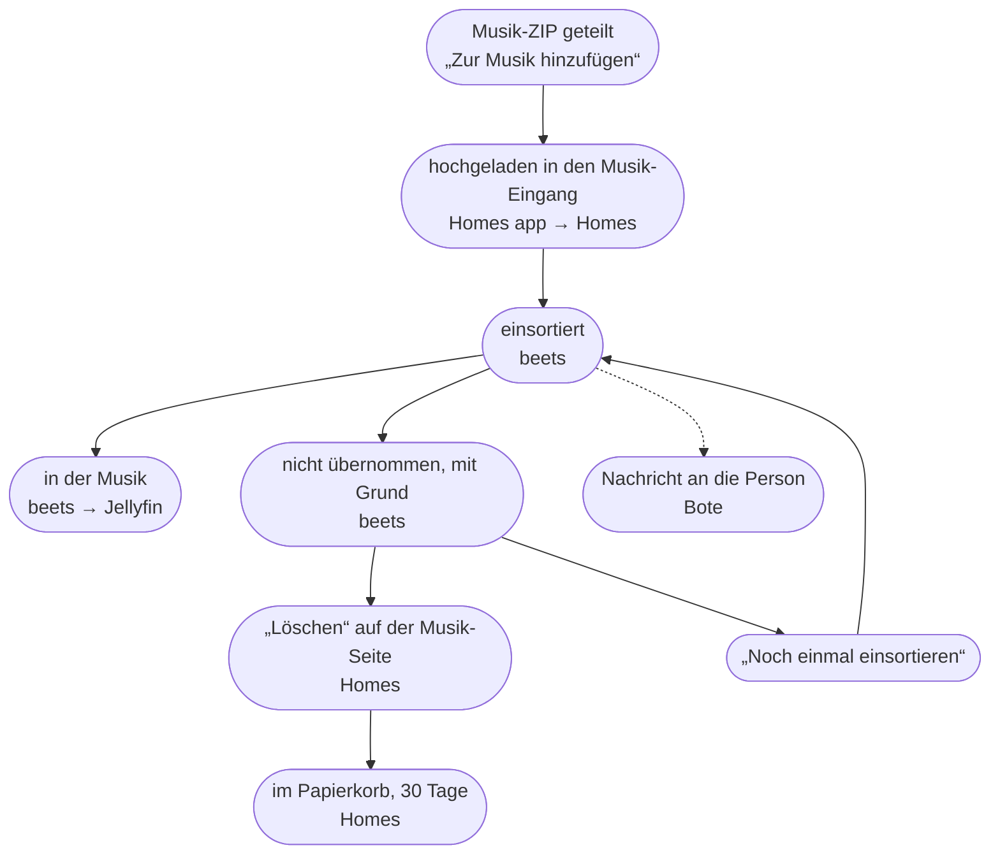
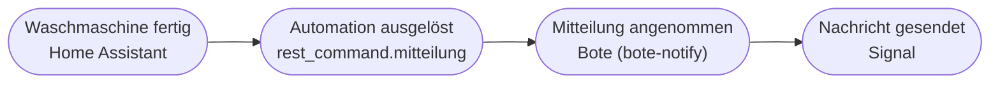
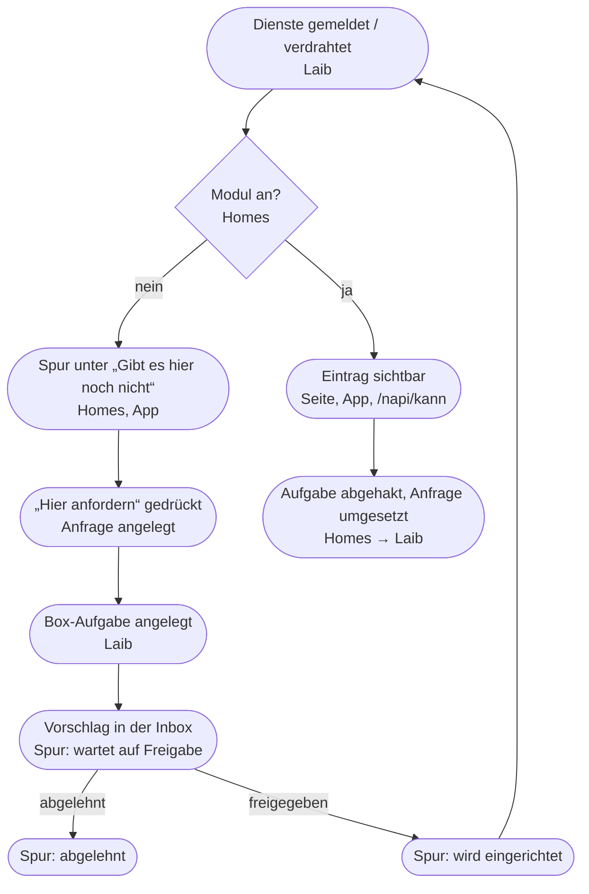

# Homes: the domain map

Homes, the Homes app and the box's services form one household system.
This page names its parts in the household's own words, says which system
owns what, and follows the chains of events as they happen in the house.
For every page and `/napi` path see [`REFERENCE.md`](REFERENCE.md); for
the decisions see [`adr/`](adr/) and Laib's
[`docs/adr`](https://github.com/mdopp/laib/tree/main/docs/adr).

The German terms are the ubiquitous language: the family reads them on
the pages and in the app, and the code uses them. They are not translated
here.

## 1. Glossary

| Term | What it is | In code / API | Owner |
|---|---|---|---|
| **Haushalt** | What the family shares, as against a person's own. | Homes' own Radicale account (`HOMES_RADICALE_USER`): the calendar „Haushalt“, the address book `haushalt-kontakte`, `familie-*` | Radicale |
| **Haushalts-Kontakte** | The household's shared address books, on every phone; one card is a Haushalts-Kontakt. | vCard in Homes' Radicale home; `/napi/gemeinsam/kontakte`; module `kontakte` | Radicale |
| **Haushalts-Kalender** | The household's shared calendars (Termine and Erinnerungen), on every phone. | VCALENDAR collections in Homes' Radicale home; `/napi/gemeinsam/kalender`; module `kalender` | Radicale |
| **Firma** (Kontakt) | A Haushalts-Kontakt Homes made for a sender of documents. Only these cards are completed from documents. | `CATEGORIES:Firma`; Bote tool `kontakt_ergaenzen` | Radicale |
| **Handy-Kontakte** | A person's own phone contacts, mirrored for their Archiv. Never shared, never sent to another phone. | address book `/<person>/handy-kontakte/`; `POST /napi/kontakte` | the phone (Radicale holds the mirror) |
| **Homes-Konto** | The Android account „Homes“: it carries the Haushalts-Kontakte, Termine and Erinnerungen into the phone's dialer, messengers and calendar. | app `konto/` (two sync adapters); module `konto`; `/napi/gemeinsam/…` | Homes app (the data: Radicale) |
| **Termin** | An appointment in a Haushalts-Kalender. | VEVENT; Bote tool `termin_anlegen` | Radicale |
| **Erinnerung** | Something due, which rings on the phones. Read-only on the phone. | VTODO with an alarm; `erinnerung_anlegen` | Radicale |
| **Einkaufsliste** | The shared shopping list: it adds up amounts and takes ingredients from recipes. | Radicale list „Einkauf“ (`internal/einkauf`); module `einkauf` | Radicale |
| **Notiz** | A note, a plain Markdown file. | `HOMES_NOTES_DIR`; module `notizen` | file-share folder |
| **Dokument** | A filed letter, invoice or file. | Paperless document; `/dokumente/<id>` | Paperless |
| **Stapel** | One run of the scanner, split into Dokumente. | Paperless custom field `Stapel`; dokumente `scan/` | dokumente |
| **Korrespondent** | Who sent a Dokument. | Paperless correspondent | Paperless |
| **Vertrag**, **Rechnung** | A Dokument of that type or tag. Its fields are read, and a notice date gets an Erinnerung. | `VERTRAG_ARTEN`, `RECHNUNG_ARTEN`; Paperless custom fields; dokumente `vertraege/` | dokumente (the fields live in Paperless) |
| **prüfen** | A tag: a person should look at this Dokument. | Paperless tag `prüfen` | dokumente sets it |
| **Archiv** | A person's own message archive (mail, WhatsApp, Signal, SMS), in a vault only that person opens. | Laib template `archiv` (msgvault), one per person; `archiv.<domain>`; `HOMES_ARCHIV_DIR/<person>` | Archiv |
| **Daten sichern** | The phone's backups going to the person's Archiv. | module `sicherung`; app `sicherung/`; `/napi/sicherung/…` | Homes app → Archiv |
| **„Dokumente“, „Nachrichten“, „Fotos“** | The links on a contact: its Dokumente in Paperless, the viewer's own messages with it in their Archiv, and the Immich person of its name. | vCard `homes-dokumente.URL`, `homes-nachrichten.URL`, `homes-fotos.URL`; `/kontakte/<uid>/dokumente`, `…/nachrichten`, `…/fotos` | Homes; made when served, never stored |
| **Gesicht** (Kontaktbild aus Immich) | The face of a contact's Immich person, as the phones' picture of a card that has none. | vCard `homes-foto.PHOTO;X-HOMES=immich`; `internal/gesichter`; `HOMES_IMMICH_KEY` | Immich (Homes keeps a small copy); made when served, never stored |
| **Person** (in Immich) | Someone Immich's face recognition knows by a name. One without a Haushalts-Kontakt is offered on Kontakte. | Immich `/api/people`; `/kontakte/aus-immich` | Immich |
| **Standortverlauf** | Where a person was: recorded by the app or imported from Google. | module `standort`; `/napi/standort`, `/napi/standort/import` | Reitti |
| **Hochladen** | The app's job for shared files: songs, albums and Takeout ZIPs. It goes on with the screen off. | app `hochladen/Hochladen.kt` | Homes app |
| **Musik-Eingang** | The inbox folder that beets sorts into the music. | `musik-eingang`; `HOMES_MUSIC_INBOX`; `/napi/musik` | beets |
| **nicht übernommen** | Music that beets kept back, with its reason. | `_nicht-importiert/<lauf>/GRUND.txt` | beets |
| **Papierkorb** | What the family deleted, kept for 30 days with *Rückgängig*. | `internal/papierkorb`; kinds `liste`, `kalender`, `termin`, `kontakt`, `musik` | Homes |
| **Mitteilung** | A message to one person, on their chat channel. | HA `rest_command.mitteilung`; Bote `POST /mitteilung` | Bote |
| **Bote** | The household's assistant in the chat (Signal). | Laib template `bote`; it calls Homes' `/mcp/haushalt` | Laib |
| **Koppeln** | Pairing a phone with Homes, which gives it a device token. | `homes_device_` tokens (old: `haus_device_`) | Homes |
| **Modul** | An area of Homes (Kalender, Dokumente, Standortverlauf, …), on or off depending on what the box runs. | `internal/modul`; `cmd/homes/module.go`; `GET /napi/kann`; `HOMES_MODULE_AUS` | Homes (from Laib's wiring) |
| **Spur** | The quiet line a missing Modul leaves under „Gibt es hier noch nicht“. | `spur_id`, `spur` in `/napi/kann`; `/mehr/spuren` | Homes |
| **Anfrage** | A request for a missing Modul („Hier anfordern“). | `laib_wish` (Laib's verb keeps its name); `wunsch.stand` in `/napi/kann` | Laib |
| **Aufgabe** (Box-Aufgabe) | A task for the box's admins in Laib. An Anfrage becomes one. | `laib_aufgabe` | Laib |
| **Vorschlag**, **Freigabe** | A change to the box that waits in Laib's Inbox for the owner's yes. | `laib propose`; Laib's Inbox | Laib |

## 2. Context map: who owns what

Each arrow points from the system that acts to the system it acts on.
Ownership is strict: each kind of data has one source of truth. Everyone
else reads it, writes it through its owner, or only links to it.

| System | Owns (source of truth) | What the others do with it |
|---|---|---|
| **Radicale** | the Haushalts-Kalender (Termine, Erinnerungen), the Haushalts-Kontakte, Handy-Kontakte, the lists (Einkauf, Musik-Wunschliste) | Homes reads and writes them over CalDAV/CardDAV and serves them to the phones. It decorates a card with its links but keeps no copy. The Archiv reads its person's Handy-Kontakte. |
| **Paperless** | Dokumente, Korrespondenten, tags, custom fields | dokumente files Stapel and fills only empty fields. Homes searches Paperless, drops uploads into its consume folder, and links into it. |
| **dokumente** (`mdopp/dokumente`) | the Stapel's state, and its record of what it read and reminded (`laib-vertraege.json`) | It is Paperless' reader. It completes contacts only through Homes' `kontakt_ergaenzen`. |
| **Archiv** (msgvault, Laib template `archiv`) | a person's messages and mail, and the vault's key | Homes only drops the phone's backups into its inbox and links to its search. It cannot read the archive. |
| **Immich** | the photos, its people and their faces (per Immich user: Homes reads the owner's) | Homes reads the named people and their faces with the owner's key, keeps small faces as a cache, and links to a person's page. It writes nothing there. |
| **Reitti** | the Standortverlauf's points | Homes passes points and imports on. It keeps only the person's Reitti token and which hours an import already brought. |
| **Home Assistant** | devices, their states, automations | Homes shows and switches them. Automations speak to people through the Bote. |
| **Bote** | the chat channel to each person (`people` in box.yml) | Home Assistant, beets and Laib send it Mitteilungen. It calls Homes' household tools. |
| **beets** | the music library, and its verdict on each upload | Homes shows the Musik-Eingang's rows and moves a deleted upload into its Papierkorb. |
| **Laib** | what the box runs, its wiring and values (`MODULE_AUS`), Anfragen, Box-Aufgaben, the Inbox | Homes asks Laib and files Anfragen. It never decides (haus#1). |
| **Homes** | the module list, the Papierkorb, the paired devices, the backup ledger, the contact links and faces (made when served), who was hidden from the Immich suggestions | the pages and `/napi` |
| **Homes app** | the phone's copy in the Homes-Konto, the Hochladen queue, positions not yet sent | It sends only through Homes' `/napi`. |

## 3. Event flows

Events are in the past tense, the way the house tells them. The second
line of a box names the system where the event happens.

### a. A Rechnung, from paper to the phone's contact

- **Rechnung gescannt:** a Stapel from the scanner or the inbox folder is
  split into Dokumente and filed into Paperless' consume folder. An
  upload from Homes' Dokumente page joins at the same point.
- **Felder gelesen:** the household model reads Betrag, Fällig am, the
  contract's dates and the sender. A value counts only when the text names
  it. Anything doubtful gets the tag `prüfen`.
- **Kontakt ergänzt:** Homes finds the Firma card by name, e-mail or IBAN,
  or makes one. It adds only what is missing and never changes a value.
  An IBAN must pass mod 97. A different IBAN is not written: the Dokument
  gets `prüfen`. A card the family made gets nothing.
- **„Dokumente“ / „Nachrichten“:** these links are made each time the card
  is served and are never stored in Radicale. A card a phone sends back
  loses them. „Dokumente“ opens the Dokumente of the Paperless
  Korrespondent with that name, or a full-text search for the name.
  „Nachrichten“ searches the *viewer's* own Archiv for the contact's
  numbers and e-mail addresses. Each link appears only when its backend
  is on the box. Away from home (for Paperless: when it is LAN-only), or
  for a viewer without an Archiv, the link opens a plain line instead.
- **„Fotos“ / the face:** „Fotos“ opens the one Immich person named as the
  contact, or Immich's search for the name. A card without a picture of
  its own reaches the phones with that person's face, made when served:
  a phone sending it back loses it again. Immich's named people without a
  contact appear on Kontakte as a quiet suggestion; only a tap makes a
  card, „ausblenden“ hides one for good.

### b. A Termin changed on a phone

- **Pushed first:** the Homes-Konto sends what changed on the phone at
  the start of each sync, before it pulls. Android's SyncManager runs the
  sync: when the switch is turned on, on „Jetzt abgleichen“, hourly, and
  on a `gemeinsam` frame of the open live stream. The app has no job of
  its own for it.
- **Haus gewinnt:** when the version differs (412), the phone drops its
  own change and takes Homes' version. The app says so in one sentence.
- **Only what a phone shows** is taken from the phone (title, place,
  times, series, alarms; for a card: names, numbers, addresses, note).
  Attendees and IBANs stay as stored. A picture the person set on the
  phone replaces the stored one; a card sent without one keeps it, and
  the face Homes added never is stored.
- **Gelöscht:** a delete on the phone moves the Termin or Kontakt into
  Homes' **Papierkorb** first, then removes it from Radicale. It can be
  restored for 30 days („Gelöscht, noch 30 Tage zurückzuholen“).
- Subscriptions (`abo-*`), mirrors and the Erinnerungen are read-only on
  the phone.

### c. Shared to the app: a Takeout, and a music ZIP

- **Before:** the person has connected Reitti once on *Standortverlauf*,
  with a Reitti token. Without it the import is refused before anything
  is uploaded.
- **Dedup, twice:** Homes remembers, per person, the hours that raw
  points (Records.json, Timeline.json, GPX) already covered. It takes the
  Semantic Location History only for hours that no raw points covered, in
  one ZIP and across a Takeout's parts. Reitti then keeps a point once
  (same device, same second), so an import sent again adds nothing.
- A Takeout part with no location history ends gently and asks for the
  other part.

- beets picks up the inbox about once a minute. What it keeps back goes
  to `_nicht-importiert/` with a `GRUND.txt`. Homes shows that as one row:
  „nicht übernommen · wann · von wem: Grund“.
- Only the uploader or an admin may delete an upload. A deleted upload
  waits in the inbox's hidden `.papierkorb`, listed in Homes' Papierkorb.

### d. Waschmaschine fertig

- No model is involved. bote-notify looks up the person in box.yml's
  `people`, refuses an unknown one, and sends the text on that person's
  preferred channel, then the next channel if one fails.
- Neither Homes nor the app is in this chain. The app shows no
  notifications; messages to people go through their chat (laib ADR 0022
  §3).

### e. A Modul's life

- **On or off:** a Modul is on when Laib's `homes` template gave Homes
  its backend: a token, a password, a folder or an address. The Module
  that only lead to another app (Fotos, Passwörter, Filme, Hörbücher)
  follow the services that Laib's status reports, checked again while
  Homes runs. The owner can switch any Modul off with `MODULE_AUS`; the
  Box page proposes that change, and the owner approves it in the Inbox.
- **Nothing is hidden:** a Modul that is off leaves a grey Spur on the web
  and in the app. Its words follow the Anfrage: „auf dieser Box nicht
  eingerichtet“ or „ausgeschaltet“, then „angefordert“, „wartet auf
  Freigabe“, „abgelehnt“ and „wird eingerichtet“.
- **Closed by Homes:** once Homes finds the Modul on, it ticks the
  Box-Aufgabe off itself, and the Anfrage becomes `umgesetzt`. Homes
  holds no verdict at any step (ADR 0001 §10).

## Keeping this current

Update this page in the same PR when you:

- add or rename a term the family or a developer meets (a page title, a
  Modul, an app account or job);
- move ownership of data from one system to another, or add a system;
- add or change a chain of events, especially who writes and who only
  links.

Keep the glossary's „in code“ column true. Every row should be findable
with one search in this repo, in homes-android, laib or dokumente.
Endpoints and fields belong in [`REFERENCE.md`](REFERENCE.md), not here.
